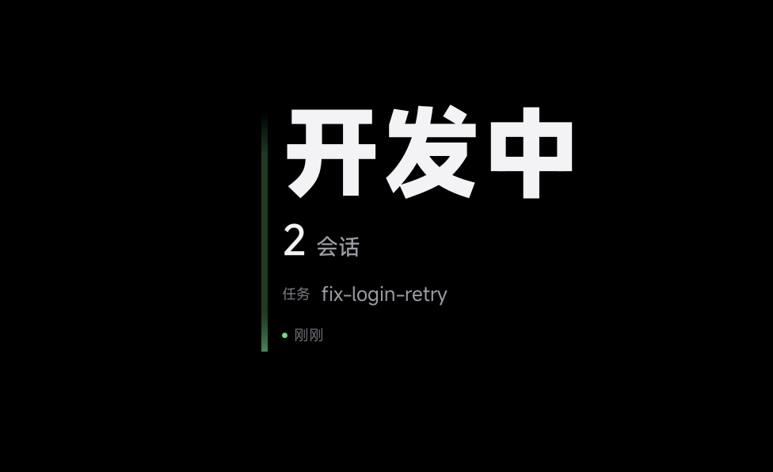
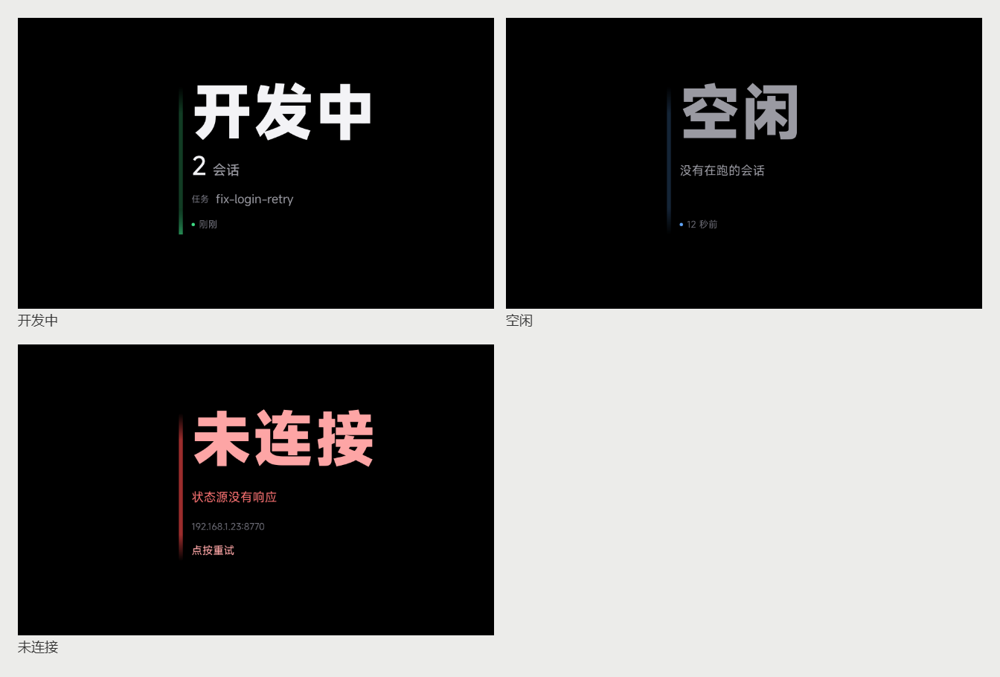
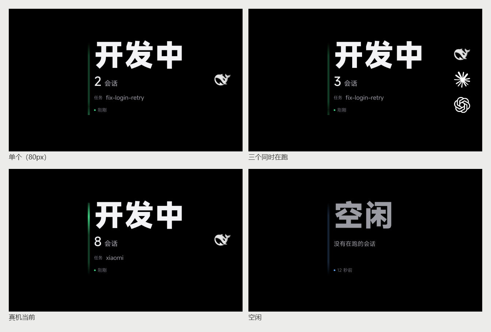
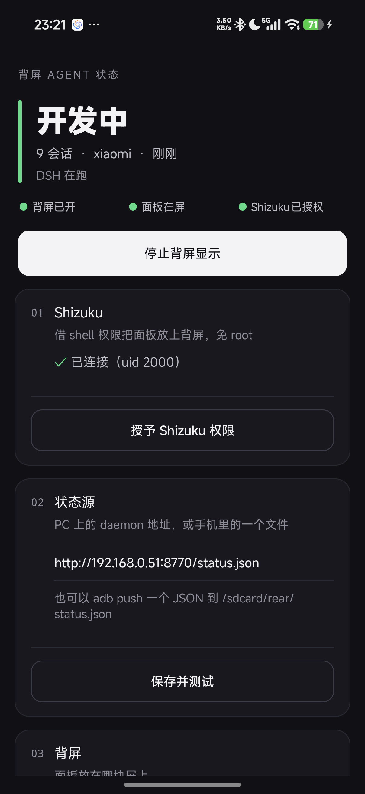
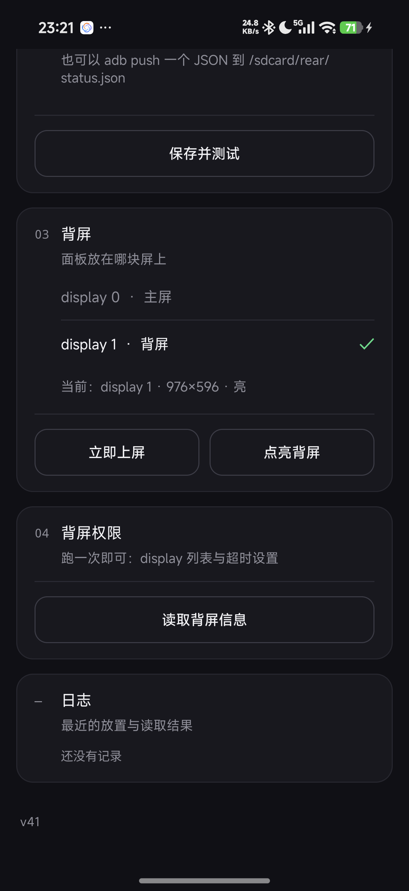

# 背屏亮点

**把电脑上正在跑的 AI Agent，放在小米手机的背屏上。**

不用 root。手机背面朝上放桌上，隔着一臂距离扫一眼，就知道 Claude Code、Codex 或 DSH 是在干活、闲着，还是连不上状态源。

[](https://github.com/fengyinxqy/rear-screen-status/releases/latest)
[](LICENSE)
[](https://developer.android.com)



## 它解决什么问题

写代码时，AI Agent 在另一块屏幕里跑着。要判断它到底在干活还是停了，得切窗口、看终端——一次两次无所谓，一天几十次就是把注意力切碎。

HyperOS 的背屏本来是给通知和自拍用的，正好适合干这件事：**它一直在那儿，但不会要求你回应。** 背屏亮点把 Agent 状态压缩成三个词（开发中 / 空闲 / 未连接）和一行读数，其余的交给设置页。

它也知道自己看不到什么：**「AI 停下来问你」和「这一轮跑完了」在会话记录里长得一样**，所以这个项目不提供「等你回答」。宁可安静，也不报一个猜出来的紧急状态。

## 界面

### 三种状态



- **开发中**——有 Agent 正在干活。大字状态词，配会话数与任务名；左侧状态脊线是一段缓慢走动的亮块。
- **空闲**——没有在跑的会话。状态词压暗，不抢注意力。
- **未连接**——状态源没有响应。整屏转红，写明原因、地址和「点按重试」，不印英文 socket 报错。

三种状态共用同一套基线：状态词、读数、任务、时间四行永远在同一个位置，眼睛不用重新找。

### 正在跑的是谁



右侧只显示**当前正在跑**的 Agent：DSH 是鲸鱼，Claude Code 是星芒，Codex 是交织结。单个标记落在固定中轴上，多个按固定顺序竖排；空闲时不占位置。

### 设置页

| 首屏 | 下半 |
|:---:|:---:|
|  |  |

首屏就是答案：当前状态的小号复刻、三个健康点（背屏已开 / 面板在屏 / Shizuku 已授权），以及唯一一个实心按钮。往下是 01 Shizuku → 02 状态源 → 03 背屏 → 04 背屏权限，一步一步来。

## 功能

- **免 root 上屏**：借 Shizuku 拿到 shell 权限，用 `am display move-stack` 把面板搬到背屏，而不是被白名单挡在门外的 `am start --display 1`。
- **亚秒级刷新**：daemon 支持长轮询，状态一变手机立刻收到（实测 0.1–0.3 秒），不是每 10 秒问一次。
- **双来源合并**：Agent hook 的推送与本地会话文件扫描**取并集**。推送说空闲、但 Codex 还在写，面板就显示开发中——一个来源不能盖住另一个。
- **只报能证明的事**：会话文件只在「仍被写入」时才算在跑；回合结束标记（Codex 的 `task_complete`、Claude 的 `stop_reason`）一出就算收工。
- **不跑偏**：面板只放在背屏；目标屏未知时隐藏退出，绝不停在主屏上吃触摸。
- **自己会爬起来**：看门狗检测轮询停摆并重启；背屏被系统熄灭时重新点亮；开机 90 秒后补一次上屏。
- **三种状态源**：PC daemon 的 HTTP、手机里的 JSON 文件（`adb push` 即可）、或任何返回同样 JSON 的服务。

## 工作原理

```
 Claude Code / Codex / DSH          ~/.claude、~/.codex 会话文件
          │ hook 推送                      │ 扫描
          └──────────────┬─────────────────┘
                         ▼
             tools/statusd.py（PC，HTTP :8770）
                GET /status.json?wait=8&since=…
                POST /push
                         │ 长轮询
                         ▼
       背屏亮点 App（前台服务，长轮询 + 看门狗）
                         │ Shizuku → am display move-stack
                         ▼
             display 1 · 976×596 · 背屏
```

面板是一个普通 Activity，被 shell 搬到 display 1；它只画 App 自己记下的最后一次读数，所以即使 PC 掉线，背屏也不会空白。

## 快速开始

**你需要**：一台有背屏的小米手机（已在 Xiaomi 17 Pro Max / HyperOS 上验证）、一台与手机同局域网的电脑、以及 [Shizuku](https://shizuku.rikka.app/)。

### 1. 电脑端：发布状态

只需要 Python 3.10+，没有第三方依赖。

```bash
git clone https://github.com/fengyinxqy/rear-screen-status.git
cd rear-screen-status

python tools/statusd.py --once                # 看一眼当前读数
python tools/statusd.py --bind 0.0.0.0        # 给手机用，监听局域网
```

启动后会打印手机该填的地址：

```
rear status daemon on http://0.0.0.0:8770/status.json
  phone URL:  http://192.168.1.23:8770/status.json
```

> 默认只监听 `127.0.0.1`。要让手机连进来，必须显式写 `--bind`（或直接给局域网 IP），并在防火墙里只放行手机。

### 2. 手机端：装上并授权

1. 安装 [Shizuku](https://shizuku.rikka.app/)（推荐 [thedjchi 的 fork](https://github.com/thedjchi/Shizuku/releases)，支持开机自启），按它的指引通过无线调试启动。
2. 安装背屏亮点 APK（[Releases](https://github.com/fengyinxqy/rear-screen-status/releases) 或自行构建，见 [docs/build.md](docs/build.md)）。
3. 打开 App → **授予 Shizuku 权限** → **状态源**填上面的 phone URL → **保存并测试** → 选 `display 1 · 背屏` → **开始背屏显示**。
4. 设置 → 应用 → 背屏亮点：打开**自启动**，省电策略选**无限制**，最近任务里加锁。否则 HyperOS 会把轮询服务冻掉。

### 3. 接入 Agent 事件（可选，但更快）

没有 hook 时，daemon 靠扫描会话文件也能工作，只是开始与结束会晚几秒。接上 hook 就是即时的：

| Agent | 事件 | 命令 |
|---|---|---|
| Claude Code | `UserPromptSubmit`、`PreToolUse` | `python tools/hook_status.py working` |
| Claude Code | `Stop` | `python tools/hook_status.py idle` |
| Codex | 会话开始 / 结束 | 同上两种 |
| DSH | 插件自动推送 | 无需配置 |

把命令写进对应 Agent 的 hooks 配置即可。`hook_status.py` 除了 POST `/push`，还会把同一份 JSON 写到 `~/.rear-status/status.json`，所以手机也可以直接读文件，不跑 daemon。

## 状态协议

一份很小的 JSON，任何能返回它的服务都能驱动面板：

```json
{
  "active": 2,
  "status": "developing",
  "detail": "fix-login-retry",
  "agents": ["dsh", "codex"],
  "updated": "2026-11-25T10:42:00+08:00"
}
```

| 字段 | 说明 |
|---|---|
| `status` | `developing` 或 `idle`。其他值（包括已退役的 `waiting`）一律按空闲处理。 |
| `active` | 在跑的会话数。 |
| `detail` | 任务名，通常取会话所在项目目录。 |
| `agents` | 在跑的 Agent 名字，可省略；也可以只给单个 `agent`。 |
| `updated` | ISO 8601 时间，用于「刚刚 / 12 秒前」。 |

daemon 端点：

| 方法 | 路径 | 用途 |
|---|---|---|
| `GET` | `/status.json` | 当前读数。`wait=<秒>` 长轮询，`since=<签名>` 让落后的调用方立刻拿到结果。 |
| `POST` | `/push` | 推一次状态，`{"status":"developing","agent":"claude"}`。推送有效期按状态计算（开发中 180 秒、空闲 300 秒）。 |
| `GET` | `/health` | 存活探针。 |

## 兼容性

- Android 11+（`minSdk 30`），编译目标 Android 16。
- 已在 **Xiaomi 17 Pro Max（M154FF）· Android 17 / HyperOS** 上实测：背屏 `display 1`，976×596。
- 其他机型未验证。背屏的 display id、可见区域和系统策略都可能不同，遇到问题请开 issue 并附上 `adb shell dumpsys display` 的输出。

## 已知限制

- **锁屏会切回系统背屏界面**：HyperOS 在某些状态下用 `SubScreenLauncher` 顶掉第三方面板。看门狗会在下一拍重新上屏，中间会闪一下。
- **非 root 设备重启后 Shizuku 会掉**：需要重新启动 Shizuku；用带开机自启的 fork 可以缓解。
- **没有「等你回答」状态**：见上文——这个信号目前无法可靠获得，猜错的代价比不报更大。
- **daemon 只覆盖本机会话**：多台电脑需要各自跑一个 daemon，或自己汇总成一份 JSON。

## 常见问题

**`INSTALL_FAILED_USER_RESTRICTED: Install canceled by user`**

HyperOS 拦截了 ADB 安装。实测有效：

```bash
adb shell settings put global adb_install_need_confirm 0
adb install -r build/rear-screen-status.apk
```

**面板跑到主屏去了**

检查设置页 03 是否选中 `display 1 · 背屏`。App 在目标屏未知时会隐藏面板而不是摆到主屏；如果你的版本仍出现该问题，请附 `adb shell dumpsys activity activities` 的 `Display #` 段落开 issue。

**背屏是黑的，但 App 说「面板在屏」**

多半是系统进入了 Dozing。点设置页的「点亮背屏」，或检查 App 的自启动与省电策略。

**状态一直不刷新**

先看手机能不能 `curl http://<PC IP>:8770/status.json`。再看 daemon 日志的时间戳——没有请求说明手机没在问（Wi-Fi 休眠、服务被冻结），有请求说明问题在 Agent 侧。

## 目录

```
app/            Android 源码（面板、设置页、Shizuku 服务）
tools/          PC 端 daemon 与 hook
tests/          daemon 端到端测试 + 解析逻辑测试
docs/           构建说明、第三方许可、截图
design/         图标源文件（SVG）
build.sh        免 Gradle 构建脚本
```

## 构建与测试

需要 Windows、Git Bash、JDK 17 和 Android SDK 36。完整步骤（含 Shizuku AAR 的获取）见 **[docs/build.md](docs/build.md)**。

```bash
bash build.sh                                 # 输出未签名 APK
python tests/test_statusd.py                  # daemon 端到端
```

## 隐私

- daemon 读取的是本机 Agent 的会话文件，输出只有状态、数量、Agent 名称和项目目录名，**不包含对话内容**。
- HTTP 服务没有 TLS 与鉴权，默认只监听 `127.0.0.1`。要给手机访问时请显式 `--bind`，并把端口限制在可信局域网；不要映射到公网。
- App 关闭了 Android 备份，设置只存在本机。
- 截图来自作者的测试机，其中的局域网地址仅作示例。

## 许可与致谢

项目原创代码采用 [MIT](LICENSE)。

背屏面板依赖独立安装的 [Shizuku](https://shizuku.rikka.app/)；构建使用 [Shizuku API](https://github.com/RikkaApps/Shizuku-API)。背屏上屏的思路参考了 [mi-back-screen](https://github.com/totallynotkasai/mi-back-screen)。完整清单与各自许可见 **[docs/third-party.md](docs/third-party.md)**。

本项目与小米、Anthropic、OpenAI、DeepSeek 均无隶属关系。
